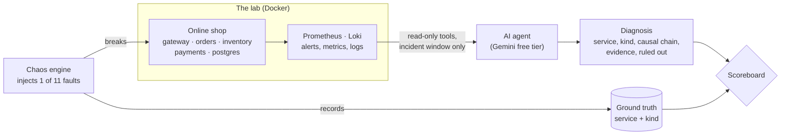

# Faultline

**Break it on purpose. Let an AI find out why.**

An AI agent that investigates outages in a live microservice system and identifies the root cause, evaluated against faults injected on purpose, each with a known ground truth.

> **Status:** built and measured over 33 investigations: the agent finds the faulty service 94% of the time and the full root cause 64% of the time (see [results](#results)).

## How it works



The agent never sees the chaos engine or its records: only the telemetry an on-call engineer would see.

## The lab

A small online shop that runs 24/7 under simulated customer traffic, monitored the way a production system would be.

```
loadgen ──► gateway ──► orders ──► inventory
 (5 req/s)   :8080        │
                          ├──► payments
                          └──► PostgreSQL

every service ──metrics──► Prometheus ──► alert rules
              ──logs────► Alloy ──► Loki
                                       └──► Grafana dashboards
```

| Service | Role |
|---|---|
| `gateway` | Public API: `GET /api/products`, `POST /api/checkout`, `GET /api/orders/{id}` |
| `orders` | Reserves stock → stores the order in Postgres → charges payment; compensates (releases stock) on failure |
| `inventory` | Product catalog and stock reservations |
| `payments` | Simulated card processor: 20–80 ms latency, ~3% declines |
| `loadgen` | Simulated customers: browse 50%, checkout 40%, track order 10% |

### Observability built in
- **Structured JSON logs** from every service, with a `request_id` propagated through the `X-Request-ID` header, so one customer request can be followed across all services in Loki.
- **Prometheus metrics**: `http_requests_total`, `http_request_duration_seconds` (by route/status), and `downstream_errors_total` (by target and kind: timeout / connection / 5xx).
- **Alert rules**: `ServiceDown`, `HighErrorRate` (>5% 5xx), `HighLatency` (p95 > 500 ms).
- **Database visibility**: `db_pool_connections{state="in_use|waiting|max"}` from orders, and PostgreSQL logs any query stuck on a lock for over 1 s.

## Run it

Requires Docker Desktop (running).

```bash
docker compose up -d --build
```

| URL | What |
|---|---|
| http://localhost:3000 | Grafana: *Shop Overview* dashboard |
| http://localhost:9090 | Prometheus: metrics, alerts |
| http://localhost:8080/api/products | The shop's public API |

Try a checkout:

```bash
curl -X POST localhost:8080/api/checkout -H "Content-Type: application/json" -d '{"sku":"SKU-001","qty":1}'
```

Stop everything with `docker compose down` (add `-v` to also wipe the database).

## The chaos engine

Injects a fault into the running lab, records the ground truth (where the fault really lives, not where the alerts fire), then reverts it. Plain Python 3.10+, no dependencies; run it from the repo root while the lab is up.

```bash
python -m chaos list                          # the fault catalog
python -m chaos inject payments-latency       # inject, wait 180 s, revert (-d to change; Ctrl-C ends early)
python -m chaos inject db-lock --detach       # inject and return
python -m chaos status                        # what is broken right now
python -m chaos clear                         # revert everything
python -m chaos runs                          # past runs and their root causes
```

| Fault | Root cause | What it looks like |
|---|---|---|
| `payments-latency` | payments / latency | charges take 1.5–2.5 s; latency alerts up the call chain, no errors |
| `payments-errors` | payments / errors | half of charges fail with 503; errors cascade to orders and gateway |
| `payments-declines` | payments / bad-config | decline rate 3% → 60%; **no alert fires** (402s aren't 5xx) |
| `orders-db-pool-leak` | orders / resource-exhaustion | orders holds every pool connection; PoolTimeouts while Postgres is healthy |
| `inventory-down` | inventory / crash | container stopped; connection errors downstream |
| `inventory-hang` | inventory / hang | container paused; timeouts instead of connection errors |
| `postgres-down` | postgres / crash | database stopped; Postgres isn't scraped, so no `ServiceDown` |
| `db-lock` | postgres / lock-contention | a "nightly-report" session holds an exclusive lock on `orders` |
| `inventory-latency` | inventory / latency | *held out*: catalog and reservations take 1.2–2 s |
| `payments-down` | payments / crash | *held out*: payments container stopped |
| `postgres-hang` | postgres / hang | *held out*: database frozen, logs nothing at all |

Several faults deliberately share symptoms (three end in the same `PoolTimeout`), so the agent has to find the evidence that tells them apart rather than pattern-match the alert.

**How faults are injected.** Infrastructure faults go through `docker compose` (stop, pause) or a rogue `psql` session. Application faults go through a hidden `/_chaos` endpoint every service mounts (`services/common/chaos.py`): it adds latency or errors to chosen routes, or triggers service-specific faults like the connection leak. That endpoint is excluded from metrics and request logs, and injected failures only log what the real failure would, so the ground truth can't be read off the telemetry. Every in-app fault also expires on its own, so a crashed controller can't leave the lab broken.

**Ground truth.** Each run writes `chaos/runs/<run_id>.json` with the fault, its root cause (service + kind), the expected signals and the exact injection window. This is what the scoreboard will grade the agent against.

## The agent

An LLM investigator that gets paged, digs through the lab's telemetry and names the root cause. It sees only what an on-call engineer would see in Grafana: alerts, metrics and logs. No Docker access, no database shell, and never the chaos engine's ground truth.

```bash
cp .env.example .env                  # then add a free Gemini API key
python -m agent investigate           # investigate the current incident
python -m agent investigate -c "customers say checkout is slow"
python -m agent investigate --provider ollama   # local model instead
```

**Tools** (all read-only, via Prometheus and Loki):

| Tool | What it gives the agent |
|---|---|
| `get_alerts` | firing and pending alerts |
| `log_summary` | log lines grouped by service, level and message, so where the noise is jumps out |
| `search_logs` | matching lines with all their fields and exception tails |
| `trace_request` | one `request_id` across every service |
| `query_metrics` | any PromQL, instant or as a compact time series |
| `submit_diagnosis` | the structured answer: service, kind, summary, evidence, confidence |

**Incident window.** Every tool only returns data from the incident window, which by default opens a minute before the earliest active alert (`--since HH:MM` to set it). The agent can narrow it but never look earlier, not even through a PromQL `[10m]` range or `offset`, so leftovers from an earlier incident can't mislead it.

**Showing its work.** A diagnosis must list the lookalike explanations the agent ruled out, with the evidence for each; one without is sent back. "High" confidence is reserved for direct evidence in the component at fault.

The system prompt describes the architecture and a general method (follow the failure down the dependency chain, confirm the mechanism, rule out lookalikes) but says nothing about the specific faults. Each investigation saves its full transcript, diagnosis and token usage to `agent/reports/`.

**Free models only.** The default is Google's Gemini free tier with `gemini-3.5-flash-lite` (pinned so scores stay comparable, and its daily allowance covers full scoreboard runs; `gemini-3.8-flash` allows only 20 requests a day); the agent retries automatically when it hits the free tier's rate limits. Ollama runs the agent fully offline (tested with `qwen3:4b`), but on a CPU-only laptop one model call takes many minutes.

## The scoreboard

Runs the agent against the faults and grades every diagnosis against the ground truth: is the **service** right, and is the **kind** of failure right too.

```bash
python -m scoreboard run                         # every dev fault once (~5 min per fault)
python -m scoreboard run --faults db-lock --repeats 3
python -m scoreboard run --split holdout         # final evaluation only
python -m scoreboard report                      # table of all saved runs
```

Each trial waits until the lab is quiet (no alerts, no 5xx), injects the fault, lets symptoms build for 90 s, investigates with the window opening 60 s before the injection, then reverts. Results, with full transcripts, are saved to `scoreboard/results/` after every trial, so an interrupted run keeps what it finished.

**Dev and holdout.** The 8 dev faults are what the agent is tuned against. The 3 held-out faults reuse known failure kinds in new places and are never looked at while tuning: they're only run at the end, so the final score measures whether the agent generalises rather than whether its prompt was fitted to the catalog.

### Results

**Main run:** `gemini-3.5-flash-lite` (free tier), **3 trials per fault**, 33 investigations, ~2–10 model calls each.

| | Trials | Service right | Fully right (service + kind) |
|---|---|---|---|
| Dev faults | 24 | **96%** | **67%** |
| **Held-out faults** (never seen while tuning) | 9 | **89%** | **56%** |
| All | 33 | **94%** | **64%** |

| Fault | Fully right | Typical mistake |
|---|---|---|
| `payments-latency`, `payments-errors`, `inventory-down`, `postgres-down` | 3/3 each | – |
| `payments-down` *(held out)* | 3/3 | – |
| `orders-db-pool-leak` | 2/3 | once blamed postgres |
| `inventory-latency` *(held out)* | 2/3 | once blamed the gateway |
| `inventory-hang` | 1/3 | calls a hang a crash |
| `db-lock` | 1/3 | calls lock contention resource exhaustion |
| `payments-declines` | 0/3 | right service, but "errors" instead of "bad-config" |
| `postgres-hang` *(held out)* | 0/3 | right service, but "resource-exhaustion" instead of "hang" |

**What it shows.** The agent finds *where* the fault is almost every time (94%); naming *what kind* of fault is the weak spot, and the misses cluster on the subtle kinds (hang, lock contention, bad config) rather than on loud ones (crashes, errors). The held-out score is a little below the dev score, as an honest holdout should be.

**History.** One trial per fault first suggested 88% fully right on dev faults after tuning (from a 62% baseline); repeating every fault three times brought that down to 67%. Single runs flatter: the repeated numbers are the real ones.

**Other models** (same agent, same faults):
- `gemini-3.8-flash`: 2/2 fully right on held-out faults, investigating more thoroughly (5–11 model calls), before its free tier's **20 requests per day** ran out. Too few trials to compare properly yet.
- `qwen3:4b` via **Ollama, fully offline** on a CPU-only laptop: diagnosed `inventory-down` correctly (inventory / crash, with a sensible causal chain), but one model call took **25 minutes**. It works; it isn't practical without a GPU.

## Tests

```bash
python -m unittest discover -s tests -t .
```

Fast, offline unit tests (standard library only) for the incident-window guards, log formatting, the investigation loop (with a scripted fake model), quota handling and scoring.
